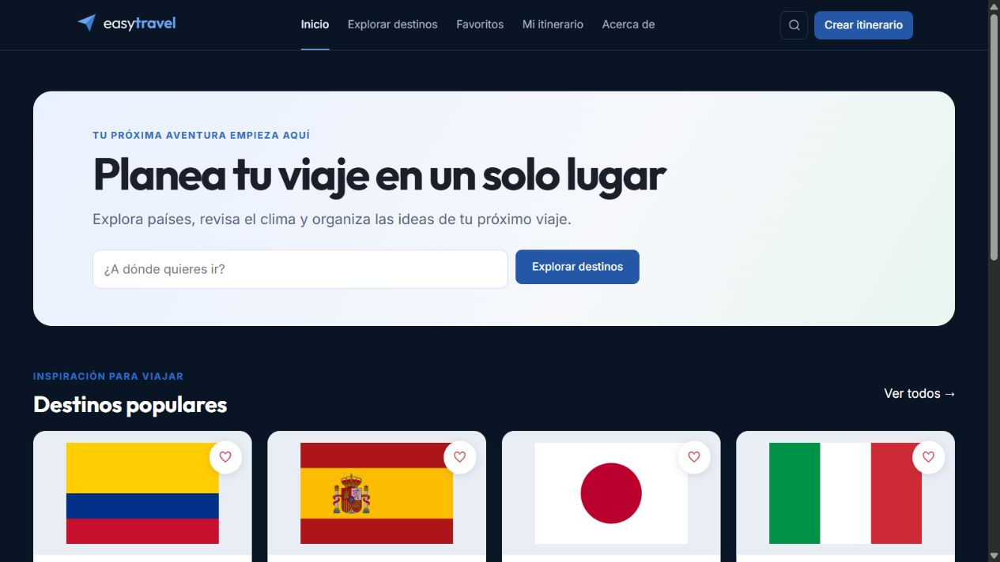
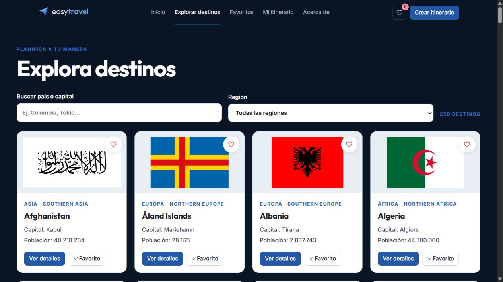
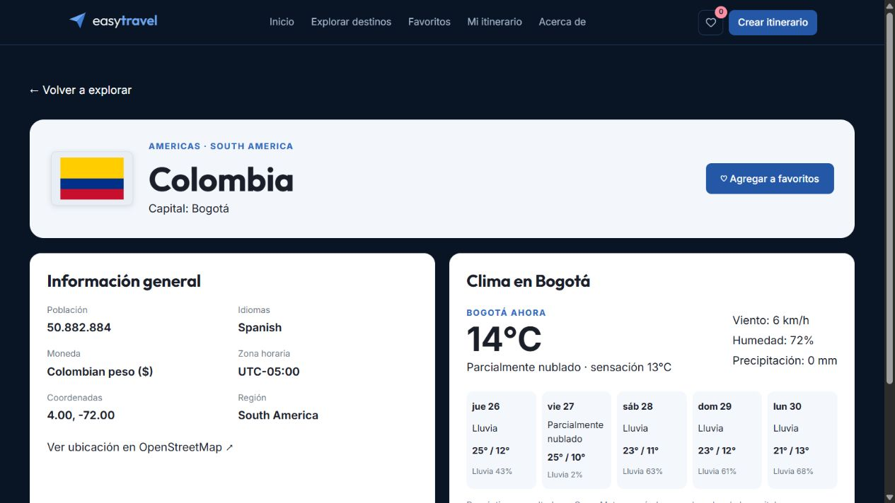
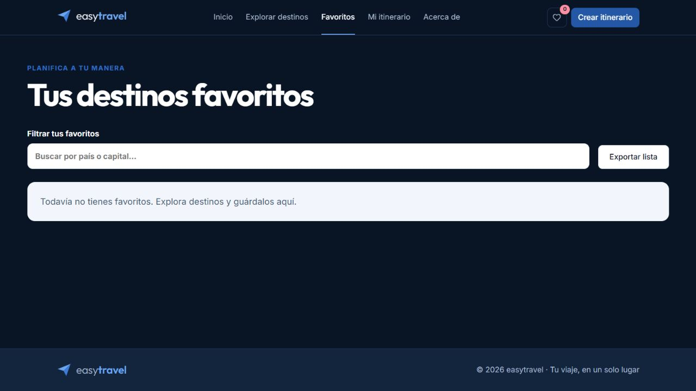
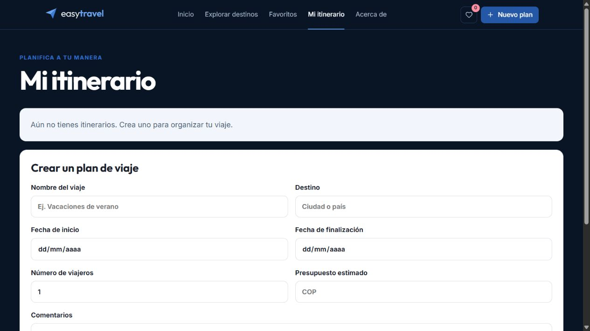

# Manual del usuario

Guía paso a paso de las funciones disponibles en easytravel.

## 1. Abrir la aplicación

Entra a la dirección web publicada o abre la carpeta del proyecto con un servidor local, por ejemplo **Live Server** de VS Code. Abrir directamente `index.html` puede impedir la carga del catálogo local. La lista y ficha de países pueden usar datos incluidos con la app; el clima requiere Internet. Los favoritos e itinerarios se guardan únicamente en el navegador y el dispositivo donde los creaste.

## 2. Página de inicio

La página de inicio explica el flujo y ofrece un buscador. Escribe un país o ciudad y pulsa **Explorar destinos**. También puedes entrar desde el menú a **Explorar destinos**.

## 3. Explorar y filtrar países

La lista se carga desde REST Countries. Si el servicio no responde, se muestra la lista local incluida con la aplicación. En **Buscar país o capital** escribe, por ejemplo, “Colombia” o “Bogotá”. El menú **Región** permite limitar la lista por continente. Cada tarjeta presenta bandera, nombre, región, capital y población.

Pulsa **Ver detalles** para abrir la ficha. El corazón o el botón **Favorito** guarda o quita el país. La búsqueda no distingue mayúsculas y minúsculas.

## 4. Consultar una ficha y el clima

La ficha se abre al seleccionar **Ver detalles**. Allí puedes revisar datos del país, abrir sus coordenadas en OpenStreetMap y guardar el destino. La app busca la ciudad capital con Nominatim/OpenStreetMap y consulta Open‑Meteo para mostrar temperatura, sensación térmica, viento, humedad, precipitación y pronóstico de cinco días.

Si no está disponible la consulta del clima, la información del país sigue visible y aparece un mensaje en el bloque meteorológico. Pulsa **Volver a explorar** para regresar.

## 5. Gestionar favoritos

Abre **Favoritos** desde el menú. Puedes buscar dentro de la lista, quitar destinos con el botón de favorito y descargar una copia JSON con **Exportar lista**. La lista evita duplicados por código de país.

## 6. Crear y administrar itinerarios

Abre **Mi itinerario** y completa el formulario: nombre, destino, fechas, viajeros y, de forma opcional, presupuesto y comentarios. Los campos requeridos se validan antes de guardar y la fecha final no puede preceder a la inicial.

En una tarjeta de itinerario agrega actividades usando el campo inferior. Puedes eliminar actividades individuales o borrar el itinerario. Los datos se guardan en el almacenamiento local del navegador.

## 7. Si algo no carga

- Confirma que el dispositivo tenga Internet y vuelve a cargar la página.
- La consulta de destinos intenta usar el catálogo local si REST Countries no responde. Para abrir una página local, inicia un servidor desde la carpeta del proyecto (por ejemplo, Live Server en VS Code); abrir directamente el archivo puede impedir cargar el catálogo local.
- Los servicios públicos pueden tener límites o interrupciones temporales.
- Si borras los datos del sitio en el navegador, perderás los favoritos e itinerarios guardados allí. Exporta tus favoritos antes de cambiar de dispositivo.
